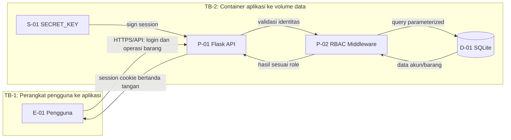

# Data Flow Diagram (DFD)

## Elemen dan trust boundary

- **E-01 Pengguna**: admin, staff, viewer.
- **P-01 Flask API**: menerima login dan permintaan inventaris.
- **P-02 RBAC middleware**: memeriksa sesi dan peran.
- **D-01 SQLite**: menyimpan akun, password hash, dan inventaris.
- **S-01 SECRET_KEY**: rahasia penandatanganan sesi.
- **B-01 Browser/session cookie**: cookie sesi pengguna.
- **TB-1**: batas antara perangkat pengguna dan jaringan aplikasi.
- **TB-2**: batas antara proses aplikasi/container dan penyimpanan persisten.
- **TB-3**: batas host Docker dan container.

## Diagram (Mermaid)

## Aliran data
1. Pengguna mengirim username dan password ke `POST /api/login`.
2. Aplikasi mengambil hash dari SQLite dan memverifikasi password dengan `check_password_hash`.
3. Jika valid, Flask membuat session cookie yang ditandatangani.
4. Setiap request berikutnya memeriksa session dan role melalui middleware.
5. Query database menggunakan parameter SQL, bukan menggabungkan input ke query.
6. API hanya mengembalikan data inventaris yang diperlukan; hash password tidak pernah dikirim ke klien.

## Batasan rancangan
DFD ini menggambarkan deployment satu container aplikasi dan satu file SQLite pada volume. Reverse proxy TLS, backup terenkripsi, dan sistem monitoring belum termasuk dalam implementasi demo.
